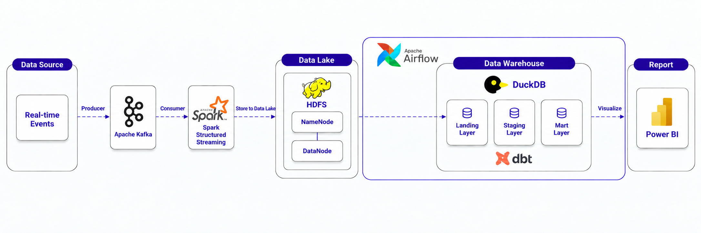

# eventsim-analystic-pipeline

## On-going

- Lý do tách eventsim ra khỏi docker-compose vì em muốn để kafka luôn chạy trước rồi mới chạy eventsim thay vì để 2 service gắn với nhau để phù hợp với thực tế.

- Hiện tại đang script đang dedupe pipeline ngay bước ingest (lý do là dedupe record trùng hoàn toàn, còn record bị trùng về nghiệp vụ sẽ được xử lý khi transform bằng dbt)

- Insight: end_time khi phát có thể null nếu nó là event cuối cùng của session.

- Phân loại:
Night: 00:00–04:59
Morning: 05:00–11:59
Afternoon: 12:00–16:59
Evening: 17:00–20:59
Night: 21:00–23:59